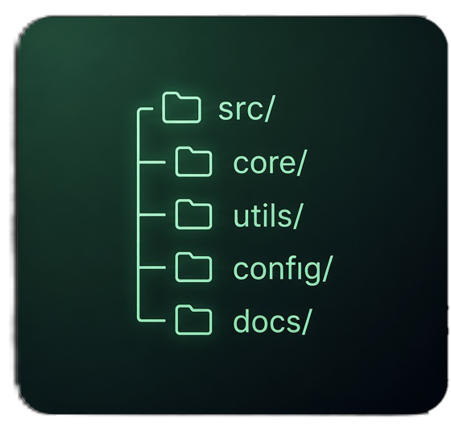

<p align="center">
  
</p>

<h1 align="center">Matewave</h1>

<p align="center">
  <a href="https://git.skysparkle.cc/kalarina/Matewave/releases"></a>
</p>

<p align="center">
  
</p>

**A beautiful, open-source chess app for Android.**

Play chess against AI, solve chess puzzles, learn and practice
chess openings, or play local multiplayer games with friends
over Bluetooth and Wi-Fi/LAN.

## Features

- 🤖 AI opponent with adjustable difficulty
- 🧩 Chess puzzles and tactical training
- 📖 Opening trainer — learn and practice opening lines and their variations
- 📶 Local multiplayer over Bluetooth or Wi-Fi/LAN, with nearby player discovery
- 📲 Share the app with a nearby friend via QR code over the local network
- 🎷 Optional built-in jazz radio
- 🌙 Dark theme
- 🌍 English, Russian, German, Japanese, Lithuanian and Chinese
- 🔓 100% open source

## Screenshots

<p align="center">
  
  
  
  
  
</p>

## Installation


1. Download the APK for the version you want from the [Releases page](https://github.com/kalarina-bit/Matewave/releases).
2. On your Android device, allow installs from unknown sources for the app you use to open the file (Settings → Apps → Special access → Install unknown apps).
3. Open the downloaded `.apk` file and confirm the install.

Or via `adb` (after downloading):

```sh
adb install Matewave-v1.0.43.apk
```

## Verifying a download


Every official APK is signed with the same key. Check the signing certificate before installing:

```sh
apksigner verify --print-certs Matewave-v1.0.43.apk
```

The SHA-256 fingerprint of the signing certificate must be:

```
1C:3E:54:54:9D:09:9A:9D:3D:5B:BE:ED:C5:63:F5:7F:60:12:56:3C:88:85:99:B1:88:B4:FB:17:E3:46:46:A9
```

(`apksigner` prints the same value in lowercase without colons.)

On Android you can check it with [AppVerifier](https://github.com/soupslurpr/AppVerifier) (app ID `cc.skysparkle.matewave`).

## Building from source

Open the project in Android Studio (a version that supports AGP 9.2) and run the `app` configuration, or:

```sh
./gradlew assembleDebug
./gradlew testDebugUnitTest   # JVM unit tests
```

Nearby multiplayer needs two physical devices — the emulator has no real Bluetooth, and mDNS discovery is often blocked on emulator networks.

## Repository structure



```
.
├── app/                 # Android app source (Kotlin, Jetpack Compose) and unit tests
├── assets/              # Icon and README images
│   └── screenshots/     # App screenshots
├── fastlane/            # F-Droid store listing, screenshots and changelogs
├── gradle/              # Gradle wrapper
├── LICENSE              # GNU GPLv3
└── README.md
```

APK builds themselves are published as assets on the [Releases page](https://github.com/kalarina-bit/Matewave/releases), not stored in this repository.

## License

This project is licensed under the **GNU General Public License v3.0 or later** (GPL-3.0-or-later) — see the [LICENSE](LICENSE) file for details.
