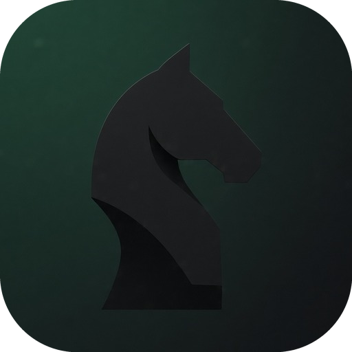
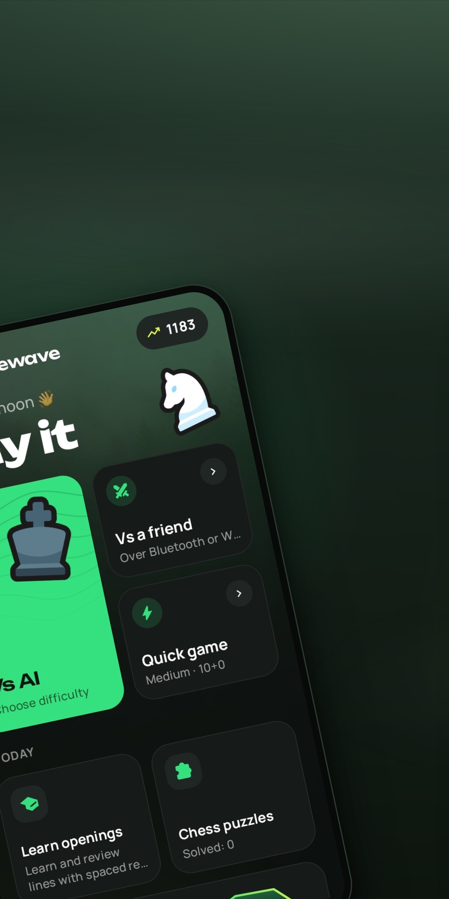
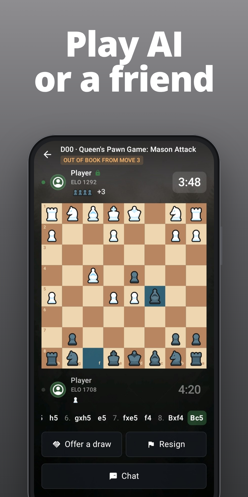
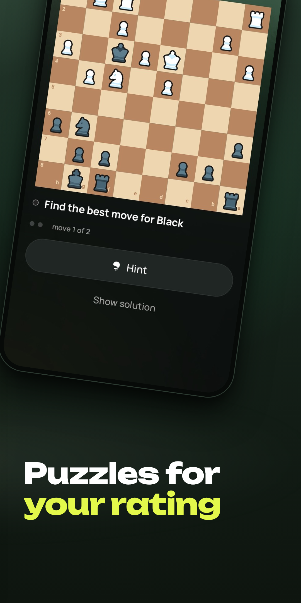
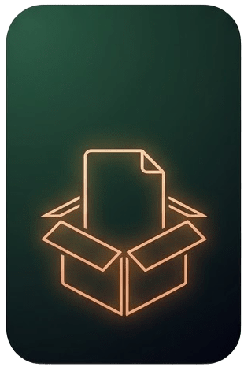
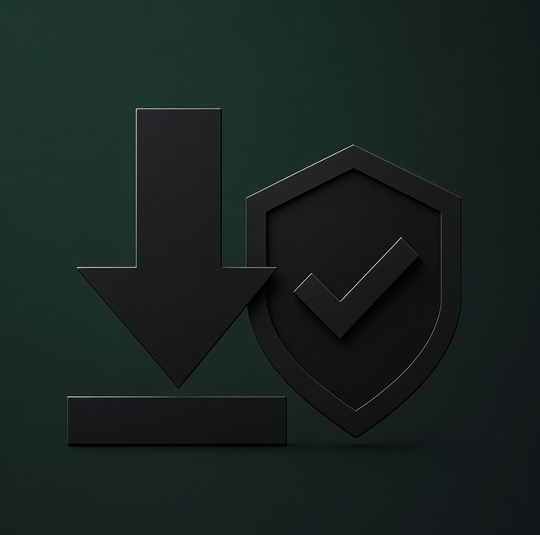
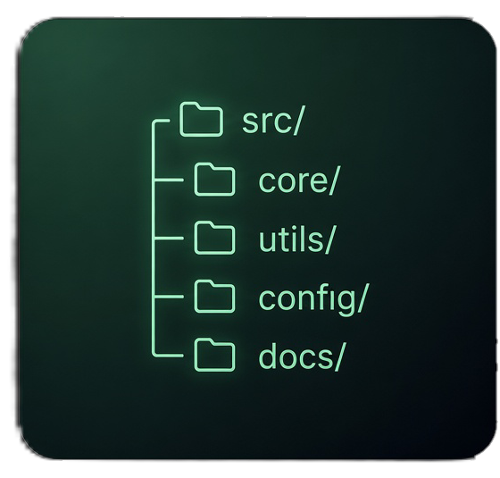

<p align="center">
  
</p>

<h1 align="center">Matewave: Offline Chess &amp; AI</h1>

<p align="center">
  <b>A friendly, open-source chess app for Android — no account, no ads.</b><br>
  Play the AI, solve puzzles, learn openings, or challenge friends nearby over Bluetooth and Wi-Fi.
</p>

<p align="center">
  <a href="https://github.com/kalarina-bit/Matewave/releases/latest"></a>
</p>

<p align="center">
  <a href="https://play.google.com/store/apps/details?id=cc.skysparkle.matewave"></a>
  <a href="https://f-droid.org/packages/cc.skysparkle.matewave/"></a>
  <a href="https://apps.obtainium.imranr.dev/redirect?r=obtainium://add/https://github.com/kalarina-bit/Matewave"></a>
  <a href="https://github.com/kalarina-bit/Matewave/releases/latest"></a>
</p>

<p align="center">
  
  
  
</p>

## ✨ What's inside

- 🤖 **AI opponent** with adjustable difficulty
- 🧩 **Puzzles** picked for your rating
- 📖 **Opening trainer** — learn lines and their variations step by step
- 📶 **Play nearby** over Bluetooth or Wi-Fi/LAN, with up to 20 spectators
- 📲 **Share the app** with a friend via QR code
- 🎷 **Optional jazz radio**, 🌙 dark theme, no ads
- 🌍 **Seven languages** — English, Russian, German, Japanese, Lithuanian, Chinese and Spanish

##  Install

Get it from **Google Play**, **F-Droid** or **Obtainium** using the buttons above — they keep the app up to date for you. You can also grab the APK from [GitHub Releases](https://github.com/kalarina-bit/Matewave/releases/latest) and install it by hand.

<details>
<summary> Verifying an APK</summary>

Every official APK is signed with the same key:

```sh
apksigner verify --print-certs Matewave-v<version>.apk
```

The SHA-256 certificate fingerprint must be:

```
1C:3E:54:54:9D:09:9A:9D:3D:5B:BE:ED:C5:63:F5:7F:60:12:56:3C:88:85:99:B1:88:B4:FB:17:E3:46:46:A9
```

`apksigner` prints it in lowercase without colons. On Android you can use [AppVerifier](https://github.com/soupslurpr/AppVerifier) (app ID `cc.skysparkle.matewave`).

</details>

##  Building

Needs JDK 17+ and Android Studio with AGP 9.2 support.

```sh
./gradlew assembleDebug
./gradlew testDebugUnitTest
```

Nearby play needs two real devices — emulators have no Bluetooth and often block mDNS.

## 🤝 Say hi

Ideas, bug reports, translation fixes and pull requests are all welcome — open an [issue](https://github.com/kalarina-bit/Matewave/issues) or write to [cuken107@proton.me](mailto:cuken107@proton.me). Please glance at [CONTRIBUTING.md](CONTRIBUTING.md) before sending code.

If you enjoy Matewave, a ⭐ helps others find it. And if you'd like to, you can also [support the project](https://buy.stripe.com/00wcN48ak8ZHgdIghof7i00) ☕

## 📄 License

[GPL-3.0-or-later](LICENSE)
