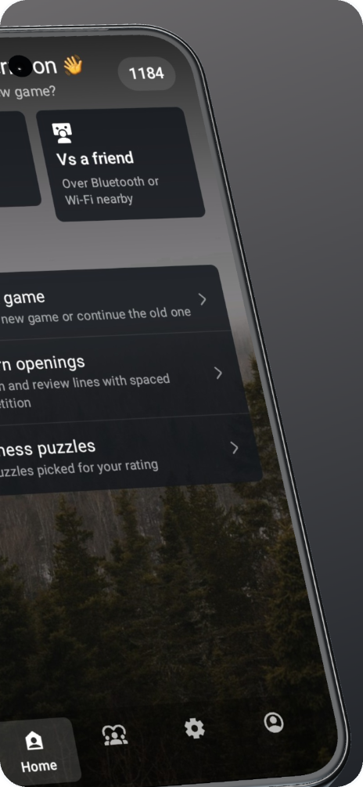
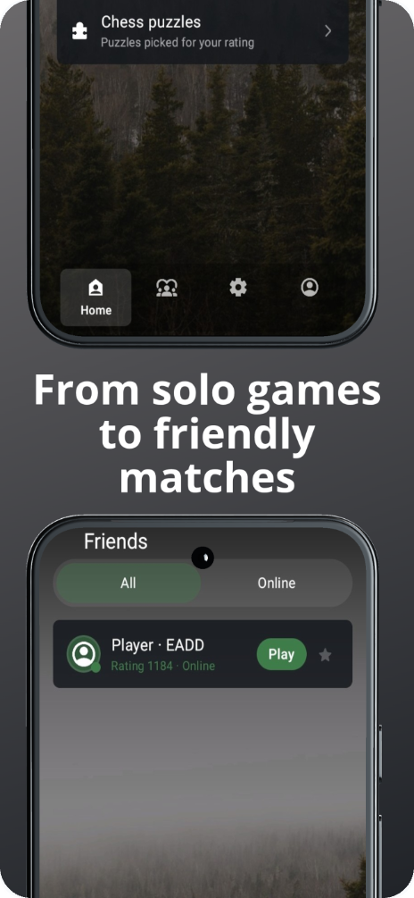
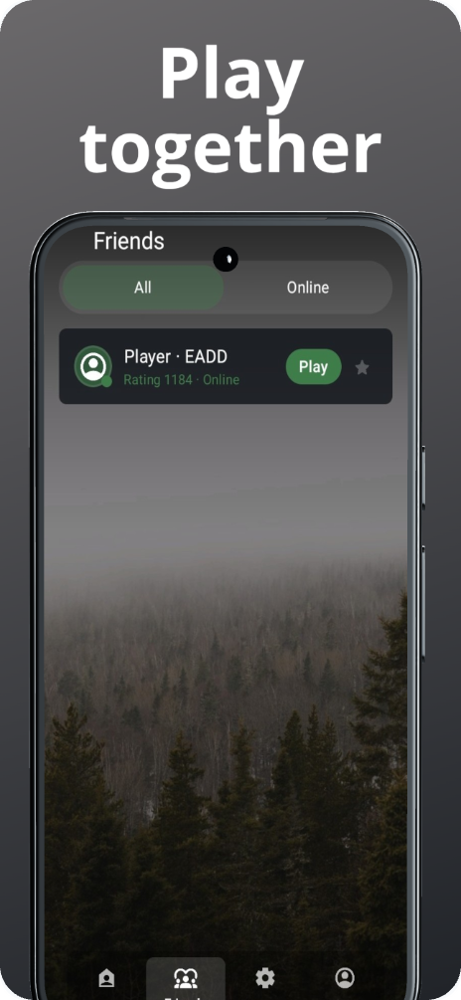
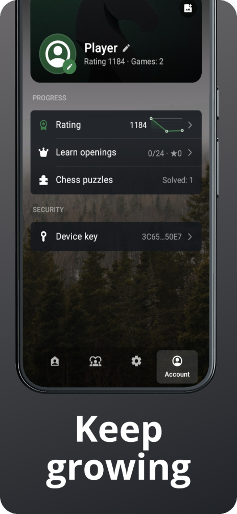
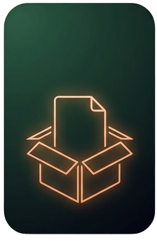
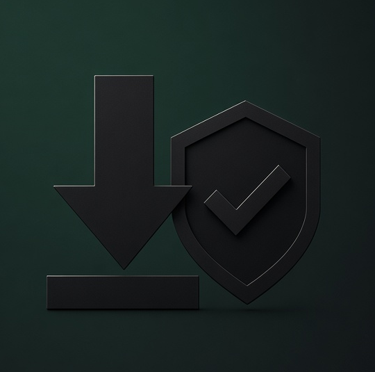

<p align="center">
  
</p>

<h1 align="center">Matewave</h1>

<p align="center"><b>A beautiful, open-source chess app for Android.</b></p>

<p align="center">
  <a href="https://git.skysparkle.cc/kalarina/Matewave/releases"></a>
</p>

<p align="center">
  
  
  
</p>

Play against the AI, solve puzzles, learn openings, or play friends nearby over Bluetooth and Wi-Fi/LAN.

## Features

- 🤖 **AI opponent** with adjustable difficulty
- 🧩 **Puzzles** and tactical training
- 📖 **Opening trainer** — learn and practice opening lines and their variations
- 📶 **Local multiplayer** over Bluetooth or Wi-Fi/LAN, with nearby player discovery
- 📲 **Share the app** with a nearby friend via QR code over the local network
- 🎷 **Optional jazz radio**
- 🌙 **Dark theme**
- 🌍 **Six languages** — English, Russian, German, Japanese, Lithuanian and Chinese

## Screenshots

<p align="center">
  
  
  
  
  
</p>

## Installation



Requires **Android 8.0 (API 26) or newer**.

1. Download the latest APK from the [Releases page](https://git.skysparkle.cc/kalarina/Matewave/releases).
2. Allow installs from unknown sources for the app you open it with (Settings → Apps → Special access → Install unknown apps).
3. Open the `.apk` file and confirm the install.

## Verifying a download



Every official APK is signed with the same key. Check it before installing:

```sh
apksigner verify --print-certs Matewave-v<version>.apk
```

The SHA-256 fingerprint of the signing certificate must be:

```
1C:3E:54:54:9D:09:9A:9D:3D:5B:BE:ED:C5:63:F5:7F:60:12:56:3C:88:85:99:B1:88:B4:FB:17:E3:46:46:A9
```

`apksigner` prints the same value in lowercase without colons. On Android you can check it with [AppVerifier](https://github.com/soupslurpr/AppVerifier) (app ID `cc.skysparkle.matewave`).

## Building from source

Requires JDK 17+ and Android Studio with AGP 9.2 support.

```sh
./gradlew assembleDebug
./gradlew testDebugUnitTest   # JVM unit tests
```

Nearby multiplayer needs two physical devices — the emulator has no real Bluetooth, and mDNS discovery is often blocked on emulator networks.

## License

[GNU General Public License v3.0 or later](LICENSE) (GPL-3.0-or-later).
